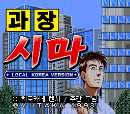
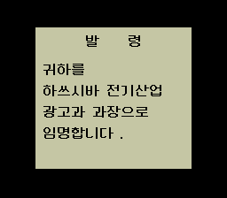
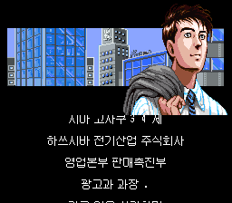
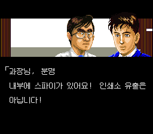
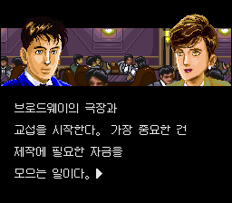
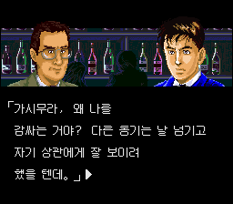
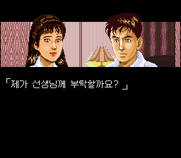
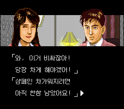
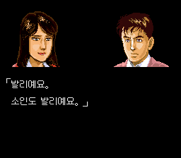
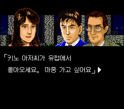

# 과장 시마 고사쿠 슈퍼 비즈니스 어드벤처

**비공식 한글판 v1.0 정식 버전 · 2026-10-21**
한글화 **기타 깎는 노인**

슈퍼패미컴 일본판 《과장 시마 고사쿠 슈퍼 비즈니스 어드벤처》의 팬 한글 패치입니다. 본편 대사와 선택지, 주요 UI, 오프닝과 엔딩을 한국어로 즐길 수 있습니다.

**[v1.0 다운로드](https://github.com/OldManCraveGuitars-bit/SFC-Kachou-Shima-Kousaku-Super-Business-Adventure-KR/releases/tag/v1.0) · [패처 포함 ZIP](https://github.com/OldManCraveGuitars-bit/SFC-Kachou-Shima-Kousaku-Super-Business-Adventure-KR/releases/download/v1.0/Kachou_Shima_Kousaku_KR_v1.0.zip) · [스크린샷 40장](docs/SCREENSHOTS.md) · [해시 확인](docs/HASHES.md)**

| 메인 타이틀 | 과장 임명장 |
| --- | --- |
|  |  |

## v1.0에서 달라진 점

- 대사와 선택지의 문맥·조사·띄어쓰기·어순을 다시 검수하고, 인물 관계에 맞게 호칭과 말투를 다듬었습니다.
- 오마치와 마리코가 시마에게 하는 말의 존대 혼용을 후반 장면까지 정리했습니다. 시마의 독백과 상대별 말투는 구분했습니다.
- 문장이 이어질 때 빠지던 공백과 어색한 줄 연결을 수정했습니다. 원래 영어 문구와 영어 느낌표도 보존했습니다.
- 누락된 엔딩 후기 5장과 일본어 원작·감수 크레딧을 한글화했습니다. 원작자 이름은 오프닝·타이틀·크레딧에서 바로잡았습니다.
- 유타카 로고를 원본과 비슷한 붉은 기울임 글씨로 디자인하고 주변의 깨진 그래픽을 수정했습니다.
- 마지막 **完**과 그 아래 중앙 정렬한 **한글화 기타 깎는 노인**은 유지했습니다.
- V0.8/V0.81의 오프닝 줌아웃·대기 데모 수정, 누락 장 제목 한글화와 **교토 편** 중앙 정렬을 포함합니다.

## 다운로드와 적용

1. [패처 포함 ZIP](https://github.com/OldManCraveGuitars-bit/SFC-Kachou-Shima-Kousaku-Super-Business-Adventure-KR/releases/download/v1.0/Kachou_Shima_Kousaku_KR_v1.0.zip)을 받아 압축을 풉니다.
2. **KachouShimaKRPatcher-v1.0.exe**를 실행합니다. Windows 64비트용이며 설치나 Python 준비가 필요 없습니다.
3. 일본판 원본 `.sfc` 또는 `.smc` 파일과 저장 위치를 선택한 뒤 **한글 패치 적용**을 누릅니다.
4. 완료 메시지의 SHA-256 검증 통과를 확인하고 생성된 한글 ROM을 실행합니다.

원본과 기존 출력 파일을 덮어쓰지 않습니다. 지원 원본에 붙은 512바이트 복사기 헤더는 검사 후 자동 제거합니다. **이전 한글판에 덧씌우지 말고 일본판 원본에 적용하세요.**

| 파일 | 용도 |
| --- | --- |
| [패처 포함 ZIP](https://github.com/OldManCraveGuitars-bit/SFC-Kachou-Shima-Kousaku-Super-Business-Adventure-KR/releases/download/v1.0/Kachou_Shima_Kousaku_KR_v1.0.zip) | EXE·IPS·사용 안내·해시·폰트 고지를 한 번에 받기 |
| [Windows 패처 EXE](https://github.com/OldManCraveGuitars-bit/SFC-Kachou-Shima-Kousaku-Super-Business-Adventure-KR/releases/download/v1.0/KachouShimaKRPatcher-v1.0.exe) | IPS가 내장된 단일 실행 파일 |
| [IPS 패치](https://github.com/OldManCraveGuitars-bit/SFC-Kachou-Shima-Kousaku-Super-Business-Adventure-KR/releases/download/v1.0/Kachou_Shima_Kousaku_KR_v1.0.ips) | 다른 IPS 도구로 직접 적용 |
| [SHA256SUMS.txt](https://github.com/OldManCraveGuitars-bit/SFC-Kachou-Shima-Kousaku-Super-Business-Adventure-KR/releases/download/v1.0/SHA256SUMS.txt) | 다운로드 파일의 SHA-256 확인 |

원본 ROM과 패치 완료 ROM은 배포하지 않습니다. GitHub의 `Source code`는 저장소 자료이며, 실행할 패처는 위 EXE 또는 ZIP으로 받으세요.

## 원본과 결과 해시

| 대상 | 크기(bytes) | SHA-256 |
| --- | ---: | --- |
| 일본판 원본 · 헤더 없음 | 1,048,576 | `988eeb2c00dedecbf18f1eb22b5c462b604ac2863a9ead3dc2118c5fefb5d4d7` |
| v1.0 패치 결과 · 헤더 없음 | 2,097,152 | `91cff6851c185e701db379cdbfe73675fbaeb008cd3667acbfa56e6d96cc982b` |
| v1.0 IPS | 466,824 | `f56c8139ded46772b0a0bfb80fd714f13bf614378993cfd5cee8286201799039` |

원본 이름은 `Kachou Shima Kousaku (Japan)`입니다. [전체 파일 해시와 SHA-1·MD5·CRC32](docs/HASHES.md), [기계 판독용 목록](docs/release_manifest.json)을 제공합니다.

## 플레이 화면

현재 수정본의 **[전체 갤러리 40장](docs/SCREENSHOTS.md)**에서 오프닝·본편·엔딩을 확인할 수 있습니다. 엔딩 이미지는 접힌 영역에 있습니다.

| 시마 고사쿠 인물 소개 | 인쇄소 정보 유출 |
| --- | --- |
|  |  |

| 브로드웨이 제작비 | 동료와의 대화 |
| --- | --- |
|  |  |

| 마리코와의 대화 | 오마치와 샴페인 |
| --- | --- |
|  |  |

| 오마치와의 여행 이야기 | 오마치와 공항으로 |
| --- | --- |
|  |  |

## 검수와 업데이트 안내

본편·선택지·오프닝의 712개 연결 본문을 다시 읽고, 별도 엔딩 후기 5장을 추가 검수했습니다. 최신 검수에서는 기존 198항목을 교정했습니다. 등록된 10,419항목 중 검수 승인 10,411항목과 비대사 제어 8항목을 구분합니다. 이 수치는 완전한 대화 화면 수가 아닌 데이터 항목 수입니다.

원문/한글 실행 화면 대조, 대기·페이지·화자 명령 검사, 원본→IPS→최종 ROM 일치 검증을 통과했습니다. 패처는 단위 검사 12개와 실제 EXE 검사 8개를 통과했습니다. 자세한 범위와 표시 제한은 [검증 기록](docs/VALIDATION.md)에 있습니다.

- 업데이트 전 SRAM(`.srm`)을 백업하세요. 이전 버전의 강제 저장 상태에는 옛 화면 데이터가 남을 수 있으므로 새 ROM을 완전히 다시 시작해 확인하세요.
- 모든 선택 조합과 모든 휴대 기기에서 다시 완주한 검사는 아닙니다. 일부 전화 장면의 그림 겹침은 검증 기록에 별도로 남겼습니다.
- 오류 제보는 [Issues](https://github.com/OldManCraveGuitars-bit/SFC-Kachou-Shima-Kousaku-Super-Business-Adventure-KR/issues)에 버전, 사용 에뮬레이터/기기, 장면과 스크린샷을 함께 남겨 주세요.

## 제작과 배포

한글화: **기타 깎는 노인**. 원작·게임·등장인물·원본 그래픽과 음악의 권리는 각 권리자에게 있습니다. 이 프로젝트는 비공식 팬 한글화이며, ‘정식 버전’은 이 팬 패치의 배포 단계를 뜻합니다.

[변경 이력](CHANGELOG.md) · [배포 및 권리 안내](NOTICE.md) · [폰트 고지](licenses/FONT-NOTICES.txt) · [이전 V0.81 화면](docs/SCREENSHOTS_V0.81.md)

## 패처 소스 사용

Python 3.10 이상에서는 `python patcher/patcher.py`로 GUI를 실행하거나 다음과 같이 적용할 수 있습니다. Windows EXE 빌드 절차는 `patcher/build_windows.ps1`에 있습니다.

```powershell
python patcher/patcher.py --input "original.sfc" --output "Shima_KR_v1.0.sfc"
```
