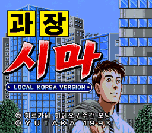
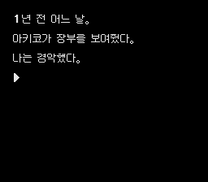
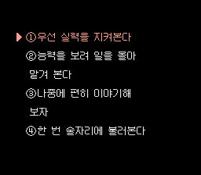
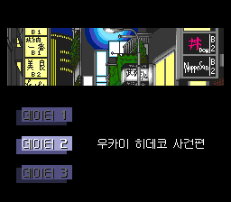
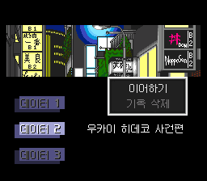
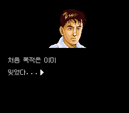

# SFC 과장 시마 고사쿠 슈퍼 비즈니스 어드벤처 한글 패치

**V0.2 공개 테스트 빌드 · 2026-10-10**

《과장 시마 고사쿠 슈퍼 비즈니스 어드벤처》는 회사원 시마 고사쿠의 업무와 인간관계를 선택지로 따라가는 슈퍼패미컴 어드벤처 게임입니다. 이 비공식 패치는 일본판의 대사·선택지와 일부 화면 글씨를 한국어로 옮깁니다. 원래 영어로 표시된 문구는 영어로 유지합니다.

> **테스트가 많이 부족합니다.** 전체 4,879칸 중 3,233칸만 검수 승인했고 **1,646칸은 미승인**입니다. 일본어 원문이 빠진 칸 205개, 원판의 시간차 글자 표시가 아직 빠진 곳 64개가 있습니다. 문맥·화자·띄어쓰기·그래픽 오류가 남아 있을 수 있으며, 모든 분기·저장 파일·에뮬레이터를 확인하지 못했습니다. [검증 범위와 해시](docs/current_validation.json)를 확인해 주세요.

## 화면

아래 여섯 장은 모두 **이번 V0.2 IPS와 같은 ROM**에서 직접 촬영했습니다.

| 타이틀 | 이야기 도입 |
| --- | --- |
|  |  |
| 첫 업무 선택지 | 불러오기 |
|  |  |
| 불러오기 선택창 | 시간차 점 표시를 복원한 독백 |
|  |  |

불러오기 화면의 거리 그림과 간판은 원래 일본판 이미지입니다. 데이터 슬롯과 선택창은 한글로 표시됩니다.

## 다운로드와 적용

[V0.2 릴리스](https://github.com/OldManCraveGuitars-bit/SFC-Kachou-Shima-Kousaku-Super-Business-Adventure-KR/releases/tag/V0.2)에서 `Kachou_Shima_Kousaku_KR_V0.2.ips`를 받으세요. 헤더 없는 일본판 원본 ROM에 IPS 패처로 적용합니다. 원본 ROM과 패치 완료 ROM은 배포하지 않습니다. 이전 상태 저장에는 화면 메모리가 남을 수 있으므로 새 게임으로 먼저 확인하고, 사용 중인 SRAM은 백업해 주세요.

GitHub가 자동으로 표시하는 `Source code (zip/tar.gz)`는 옛 V0.2 태그의 스냅샷입니다. **2026-10-10 빌드는 릴리스의 첨부 IPS와 EXE를 사용하세요.**

| 파일 | 크기 | SHA-256 |
| --- | ---: | --- |
| 일본판 원본 ROM | 1,048,576 bytes | `988eeb2c00dedecbf18f1eb22b5c462b604ac2863a9ead3dc2118c5fefb5d4d7` |
| V0.2 IPS | 244,455 bytes | `b88ba1859862272934ab2fde3b2c9dbea987f74e37ad4e75db45807ced99c972` |
| 패치 결과 ROM | 2,097,152 bytes | `adeccae271103783dfe68df0c8c8cf730a9dd7dd078af09383eff55595ed5394` |

## 대본 수정 도구

같은 릴리스의 `KachouShimaDialogueEditor.exe`는 현재 등록된 **4,879칸**의 대사를 주소별로 검색·수정할 수 있는 Windows 프로그램입니다. 일본어 원문, 한글 초안, 앞뒤 문맥, 화자와 말투 기록, 원판 바이트, 줄바꿈과 화면 넘김을 함께 보여 주며 CSV로 내보내고 가져올 수 있습니다. 원문이 비어 있는 205칸과 등록 밖 후보도 있으므로 **도구에 보인다는 이유만으로 검수가 끝난 대사로 간주하면 안 됩니다.** 수정 도구 SHA-256은 [`SHA256SUMS.txt`](SHA256SUMS.txt)에 있습니다.

## 확인한 범위

- IPS를 원본 ROM에 적용한 결과가 현재 ROM과 바이트 단위로 일치합니다.
- 등록 대사 4,879칸의 화면 넘김 수를 원판과 대조해 불일치 0건을 확인했습니다.
- 새 게임으로 초반과 down1·down3 경로의 일부 화면을 원판과 비교했습니다. 이는 전체 분기 검사가 아닙니다.
- DATA 2를 선택한 뒤 재시작·A/X 입력에서 거리 배경이 원판과 **각 39프레임** 일치하고 팝업 테두리가 유지되는 것을 확인했습니다.
- 대본 수정 EXE의 자체 검사, CSV 왕복, 창 실행 검사를 통과했습니다.

대사 뜻·말투·화자, 다른 선택지 경로, 저장 슬롯 전체, 장시간 플레이와 다른 에뮬레이터 검수는 계속 진행 중입니다. [변경 기록](CHANGELOG.md)과 [배포·권리 안내](NOTICE.md)를 참고하세요.
