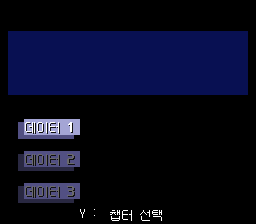
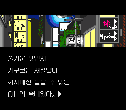

# 과장 시마 고사쿠 슈퍼 비즈니스 어드벤처

**비공식 한글판 v1.11 · 인명 정정·문맥 재검수 · 2026-11-14**
한글화 **기타 깎는 노인**

슈퍼패미컴 일본판의 팬 한글 패치입니다. v1.1의 챕터 선택 기능을 유지하면서 **도리우미 가쿠코의 이름과 관련 대사·장 제목·메뉴를 바로잡고 문맥을 재검수**했습니다.

**[v1.11 다운로드](https://github.com/OldManCraveGuitars-bit/SFC-Kachou-Shima-Kousaku-Super-Business-Adventure-KR/releases/tag/v1.11) · [패처 포함 ZIP](https://github.com/OldManCraveGuitars-bit/SFC-Kachou-Shima-Kousaku-Super-Business-Adventure-KR/releases/download/v1.11/Kachou_Shima_Kousaku_KR_v1.11.zip) · [챕터 선택 사용법](docs/CHAPTER_SELECT.md) · [신규 스크린샷 16장](docs/SCREENSHOTS.md) · [해시](docs/HASHES.md)**

| 불러오기 화면의 챕터 선택 안내 | 데이터 3 슬롯 선택 |
| --- | --- |
|  |  |

## v1.11에서 달라진 점

- **鳥海赫子(とりうみ かくこ)의 이름을 ‘토리우미 아키코’에서 ‘도리우미 가쿠코’로 바로잡았습니다.** 대사·선택지·공용 이름 표시·장 제목·챕터 선택 메뉴에 반영했습니다.
- 주요 인물의 성·이름을 원문과 대조하고, 10,419개 등록 항목을 스캔했습니다. 인명 표기 30개 항목과 별도 문맥 2개 항목을 수정했습니다.
- ‘잘도 말했다’를 ‘재잘댔다’로 다듬고 ‘가쿠코와의 관계’의 빠진 조사를 복원했습니다. 가쓰코 장면의 말줄임표와 후반 대사의 생략된 주어도 바로잡았습니다.
- 실존 시인 **요사노 아키코(与謝野晶子)**는 다른 인물이며 올바른 이름이므로 유지했습니다.
- v1.1의 다섯 챕터 선택과 일반 저장 호환을 유지합니다. **엔딩 후 저장 삭제는 원작 동작 그대로입니다.**
- Windows 패처·IPS·ZIP·해시 목록을 갱신하고 v1.11 실행 화면 16장을 추가했습니다.

[인명 정정 근거와 검수 내역](docs/NAMES_AND_REVIEW.md)

## 챕터 선택 사용법

1. **불러오기 화면에서 DATA 1~3 중 사용할 저장 슬롯을 선택합니다.**
2. SNES 패드의 **Y** 버튼을 눌러 챕터 선택 화면을 엽니다.
3. **↑/↓**로 장을 고르고 **A**를 누릅니다.
4. 장 이름과 저장 슬롯을 확인한 뒤 **A**를 한 번 더 누르면 시작합니다.
5. **B**를 누르면 이전 화면으로 돌아갑니다. 시작을 확정하기 전 취소하면 저장은 바뀌지 않습니다.

| 선택할 수 있는 장 |
| --- |
| 도리우미 가쿠코 사건 편 |
| 뉴욕 편 |
| 내부자 거래 편 |
| 교토 편 |
| 사장 교체극 편 |

| 데이터 2 슬롯 선택 | 도리우미 가쿠코 사건 편 시작 확인 |
| --- | --- |
|  |  |

**선택한 장을 처음부터 시작하며, 선택한 슬롯의 기존 진행과 이전 선택은 초기화됩니다.** 확인 화면에서 시작을 확정해야 저장이 바뀝니다. 다른 두 슬롯의 기록은 유지되며 일반 불러오기와 자동 저장도 기존 방식대로 사용할 수 있습니다.

**엔딩 후 저장이 사라지는 것은 원작 동작입니다. v1.11에서도 그대로 유지했습니다.** 다시 원하는 장을 플레이하려면 불러오기에서 Y로 챕터를 선택하세요.

## 다운로드와 적용

1. [패처 포함 ZIP](https://github.com/OldManCraveGuitars-bit/SFC-Kachou-Shima-Kousaku-Super-Business-Adventure-KR/releases/download/v1.11/Kachou_Shima_Kousaku_KR_v1.11.zip)을 받아 압축을 풉니다.
2. **KachouShimaKRPatcher-v1.11.exe**를 실행합니다. Windows 64비트용이며 Python 설치는 필요 없습니다.
3. 지원하는 일본판 원본 `.sfc`/`.smc`와 새 저장 위치를 선택하고 **한글 패치 적용**을 누릅니다.
4. SHA-256 검증 통과 메시지를 확인한 뒤 새 ROM을 실행합니다.

**v1.0을 포함한 이전 한글판에 덧씌우지 말고 일본판 원본에 적용하세요.** 원본과 기존 출력 파일은 덮어쓰지 않으며, 지원 원본의 512바이트 복사기 헤더는 자동 처리합니다.

| 파일 | 용도 |
| --- | --- |
| [패처 포함 ZIP](https://github.com/OldManCraveGuitars-bit/SFC-Kachou-Shima-Kousaku-Super-Business-Adventure-KR/releases/download/v1.11/Kachou_Shima_Kousaku_KR_v1.11.zip) | EXE·IPS·챕터 사용법·해시·폰트 고지 |
| [Windows 패처 EXE](https://github.com/OldManCraveGuitars-bit/SFC-Kachou-Shima-Kousaku-Super-Business-Adventure-KR/releases/download/v1.11/KachouShimaKRPatcher-v1.11.exe) | IPS가 내장된 단일 실행 파일 |
| [IPS 패치](https://github.com/OldManCraveGuitars-bit/SFC-Kachou-Shima-Kousaku-Super-Business-Adventure-KR/releases/download/v1.11/Kachou_Shima_Kousaku_KR_v1.11.ips) | 다른 IPS 도구로 적용 |
| [SHA256SUMS.txt](https://github.com/OldManCraveGuitars-bit/SFC-Kachou-Shima-Kousaku-Super-Business-Adventure-KR/releases/download/v1.11/SHA256SUMS.txt) | 다운로드 파일 SHA-256 확인 |

원본 ROM과 패치 완료 ROM은 배포하지 않습니다. GitHub의 `Source code` 대신 위 EXE 또는 ZIP을 받으세요.

## 원본과 결과 해시

| 대상 | 크기(bytes) | SHA-256 |
| --- | ---: | --- |
| 일본판 원본 · 헤더 없음 | 1,048,576 | `988eeb2c00dedecbf18f1eb22b5c462b604ac2863a9ead3dc2118c5fefb5d4d7` |
| v1.11 패치 결과 · 헤더 없음 | 2,097,152 | `a2bdd89e572f1640c5675fc3c9f88a502da6d8f8dcf37dbd8871f425e66b027b` |
| v1.11 IPS | 484,027 | `af64d0d4aa28ea7010539f5b45ac11274b665692988d010e5aecb6c72b839048` |

[전체 파일 해시와 SHA-1·MD5·CRC32](docs/HASHES.md) · [기계 판독용 목록](docs/release_manifest.json)

## 플레이 화면

| 가쿠코가 도운 사건 | 술자리 서술의 자연스러운 표현 |
| --- | --- |
|  |  |

| 가쓰코 장면의 문장 연결 | 뉴욕 편 진행 |
| --- | --- |
|  |  |

[v1.11 신규 갤러리 16장](docs/SCREENSHOTS.md)과 [v1.0 오프닝·본편·엔딩 갤러리 40장](docs/SCREENSHOTS_v1.0.md)을 제공합니다. 각 갤러리는 촬영 버전을 구분해 표시합니다.

## 기존 저장과 검증

기존 일반 저장(SRAM, `.srm`)과 호환됩니다. ROM 이름을 바꿨다면 저장을 백업하고 새 ROM 이름에 맞춰 저장 파일을 복사하세요. 새 ROM을 완전히 다시 시작해 사용하세요. 이전 ROM의 강제 저장 상태(`.state` 등)는 일반 저장과 별개입니다.

Snes9x·bsnes에서 챕터 진입과 초기 대사, 일반 저장 불러오기, 세 슬롯 각각의 기록 보존, 취소와 기존 화면 복귀를 검사했습니다. 패처 단위 검사 12개와 실제 EXE 검사 8개도 통과했습니다. [검증 범위와 이전 검수 기록](docs/VALIDATION.md)을 공개합니다. 전체 선택 조합과 모든 휴대 기기를 다시 완주한 검사는 아닙니다.

오류 제보는 [Issues](https://github.com/OldManCraveGuitars-bit/SFC-Kachou-Shima-Kousaku-Super-Business-Adventure-KR/issues)에 버전·기기·장면과 스크린샷을 남겨 주세요.

## 제작과 배포

한글화 **기타 깎는 노인**. 비공식 팬 한글화이며 원작·게임·등장인물·그래픽·음악의 권리는 각 권리자에게 있습니다. 마지막 **完**과 그 아래 중앙 정렬한 한글화 표기를 유지합니다.

[변경 이력](CHANGELOG.md) · [배포 안내](NOTICE.md) · [폰트 고지](licenses/FONT-NOTICES.txt)

## 패처 소스 사용

Python 3.10 이상에서 `python patcher/patcher.py`로 GUI를 실행할 수 있습니다. Windows EXE 빌드는 `patcher/build_windows.ps1`을 사용합니다.

```powershell
python patcher/patcher.py --input "original.sfc" --output "Shima_KR_v1.11.sfc"
```
