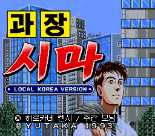
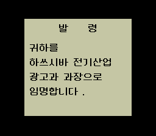
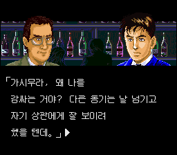
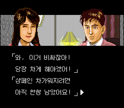
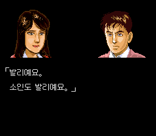
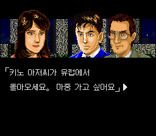

# 비공식 한글판 v1.0 정식 버전

과장 시마 고사쿠 슈퍼 비즈니스 어드벤처 · 2026-10-21
한글화 **기타 깎는 노인**

**[패처 포함 ZIP](https://github.com/OldManCraveGuitars-bit/SFC-Kachou-Shima-Kousaku-Super-Business-Adventure-KR/releases/download/v1.0/Kachou_Shima_Kousaku_KR_v1.0.zip) · [패처 EXE](https://github.com/OldManCraveGuitars-bit/SFC-Kachou-Shima-Kousaku-Super-Business-Adventure-KR/releases/download/v1.0/KachouShimaKRPatcher-v1.0.exe) · [IPS](https://github.com/OldManCraveGuitars-bit/SFC-Kachou-Shima-Kousaku-Super-Business-Adventure-KR/releases/download/v1.0/Kachou_Shima_Kousaku_KR_v1.0.ips) · [스크린샷 40장](https://github.com/OldManCraveGuitars-bit/SFC-Kachou-Shima-Kousaku-Super-Business-Adventure-KR/blob/v1.0/docs/SCREENSHOTS.md)**

## 주요 변경

- 대사와 선택지의 문맥·조사·띄어쓰기·어순을 다시 검수하고, 인물 관계에 맞게 호칭과 말투를 다듬었습니다.
- 오마치와 마리코가 시마에게 하는 말의 존대 혼용을 후반 장면까지 정리했습니다. 시마의 독백과 상대별 말투는 구분했습니다.
- 문장이 이어질 때 빠지던 공백과 어색한 줄 연결을 수정했습니다. 원래 영어 문구와 영어 느낌표도 보존했습니다.
- 누락된 엔딩 후기 5장과 일본어 원작·감수 크레딧을 한글화했습니다. 원작자 이름은 오프닝·타이틀·크레딧에서 바로잡았습니다.
- 유타카 로고를 원본과 비슷한 붉은 기울임 글씨로 디자인하고 주변의 깨진 그래픽을 수정했습니다.
- 마지막 **完**과 그 아래 중앙 정렬한 **한글화 기타 깎는 노인**은 유지했습니다.
- V0.8/V0.81의 오프닝 줌아웃·대기 데모 수정, 누락 장 제목 한글화와 **교토 편** 중앙 정렬을 포함합니다.

## 적용 방법

ZIP을 풀고 패처를 실행한 뒤 일본판 원본 ROM과 저장 위치를 선택하세요. Python은 필요 없습니다. 이전 한글판에 덧씌우지 않고 원본에 적용합니다. 원본·기존 출력 파일은 보존하며, 지원 원본의 512바이트 복사기 헤더는 자동 처리합니다.

| 대상 | 크기(bytes) | SHA-256 |
| --- | ---: | --- |
| 일본판 원본 | 1,048,576 | `988eeb2c00dedecbf18f1eb22b5c462b604ac2863a9ead3dc2118c5fefb5d4d7` |
| 정상 패치 결과 | 2,097,152 | `91cff6851c185e701db379cdbfe73675fbaeb008cd3667acbfa56e6d96cc982b` |
| IPS | 466,824 | `f56c8139ded46772b0a0bfb80fd714f13bf614378993cfd5cee8286201799039` |

배포 파일별 해시는 첨부된 `SHA256SUMS.txt`, `release-manifest-v1.0.json`과 [해시 안내](https://github.com/OldManCraveGuitars-bit/SFC-Kachou-Shima-Kousaku-Super-Business-Adventure-KR/blob/v1.0/docs/HASHES.md)에 있습니다. 원본 ROM과 패치 완료 ROM은 포함하지 않습니다.

## 화면

| 메인 타이틀 | 과장 임명장 |
| --- | --- |
|  |  |

| 동료와의 대화 | 오마치와 샴페인 |
| --- | --- |
|  |  |

| 오마치와의 여행 이야기 | 오마치와 공항으로 |
| --- | --- |
|  |  |

엔딩 크레딧·유타카 로고 보기 · 스포일러

| 원작·감수 크레딧 | 유타카 한글 로고 |
| --- | --- |
|  |  |

## 검증과 업데이트 안내

본문·선택지·오프닝의 712개 연결 본문 재독, 엔딩 후기 5장 추가 검수, 최신 원판/한글 화면 대조를 반영했습니다. 실제 패처 EXE 8개 검사와 단위 검사 12개, IPS 재적용 후 최종 해시 일치 검증을 통과했습니다. [검증 범위와 표시 제한](https://github.com/OldManCraveGuitars-bit/SFC-Kachou-Shima-Kousaku-Super-Business-Adventure-KR/blob/v1.0/docs/VALIDATION.md)을 함께 공개합니다.

SRAM을 백업하고 새 ROM을 완전히 다시 시작해 확인하세요. 모든 선택 조합과 모든 기기를 재생한 검사는 아니며, 일부 전화 장면의 그림 겹침은 검증 기록에 명시했습니다. 오류는 [Issues](https://github.com/OldManCraveGuitars-bit/SFC-Kachou-Shima-Kousaku-Super-Business-Adventure-KR/issues)에 버전·기기·장면과 스크린샷을 남겨 주세요.

비공식 팬 한글화입니다. 정식 버전은 이 팬 패치의 배포 단계를 뜻합니다.
