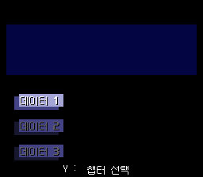
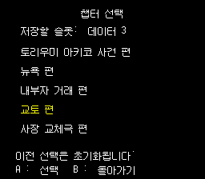
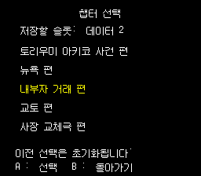
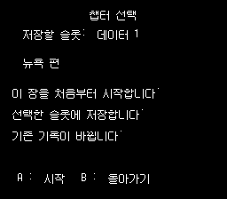
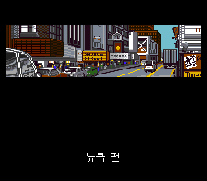
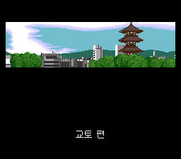
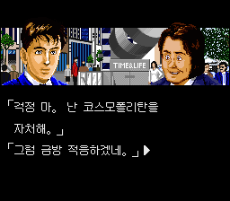
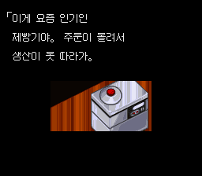

# 비공식 한글판 v1.1 · 챕터 선택 추가

과장 시마 고사쿠 슈퍼 비즈니스 어드벤처 · 2026-10-21
한글화 **기타 깎는 노인**

**[패처 포함 ZIP](https://github.com/OldManCraveGuitars-bit/SFC-Kachou-Shima-Kousaku-Super-Business-Adventure-KR/releases/download/v1.1/Kachou_Shima_Kousaku_KR_v1.1.zip) · [패처 EXE](https://github.com/OldManCraveGuitars-bit/SFC-Kachou-Shima-Kousaku-Super-Business-Adventure-KR/releases/download/v1.1/KachouShimaKRPatcher-v1.1.exe) · [IPS](https://github.com/OldManCraveGuitars-bit/SFC-Kachou-Shima-Kousaku-Super-Business-Adventure-KR/releases/download/v1.1/Kachou_Shima_Kousaku_KR_v1.1.ips) · [신규 스크린샷 16장](https://github.com/OldManCraveGuitars-bit/SFC-Kachou-Shima-Kousaku-Super-Business-Adventure-KR/blob/v1.1/docs/SCREENSHOTS.md)**

## 주요 변경

- **불러오기 화면에 챕터 선택 기능을 추가했습니다.** 저장 데이터가 없어도 다섯 장을 골라 처음부터 시작할 수 있습니다.
- DATA 1~3 중 사용할 슬롯을 고른 뒤 **Y**를 누르면 챕터 목록이 열립니다.
- 시작 전에 선택한 장과 저장 슬롯을 확인합니다. 확정한 슬롯의 진행과 이전 선택만 초기화되며, 나머지 두 슬롯은 유지됩니다.
- **엔딩 후 저장 데이터가 사라지는 원작 동작은 그대로 유지했습니다.** 챕터 선택은 저장 복구가 아니라 해당 장을 새로 시작하는 기능입니다.
- v1.0의 대사 재검수, 오프닝·엔딩 한글화, 유타카 로고와 그래픽 수정이 모두 포함됩니다.
- v1.1 전용 Windows 패처·IPS·해시 목록과 실제 실행 스크린샷 16장을 제공합니다.

## 챕터 선택 조작법

1. **불러오기 화면에서 DATA 1~3 중 사용할 저장 슬롯을 선택합니다.**
2. SNES 패드의 **Y** 버튼을 눌러 챕터 선택 화면을 엽니다.
3. **↑/↓**로 장을 고르고 **A**를 누릅니다.
4. 장 이름과 저장 슬롯을 확인한 뒤 **A**를 한 번 더 누르면 시작합니다.
5. **B**를 누르면 이전 화면으로 돌아갑니다. 시작을 확정하기 전 취소하면 저장은 바뀌지 않습니다.

| 선택할 수 있는 장 |
| --- |
| 토리우미 아키코 사건 편 |
| 뉴욕 편 |
| 내부자 거래 편 |
| 교토 편 |
| 사장 교체극 편 |

| 불러오기 화면의 Y: 챕터 선택 안내 | 데이터 3에서 교토 편 선택 |
| --- | --- |
|  |  |

| 데이터 2에서 내부자 거래 편 선택 | 시작 전 선택 슬롯 덮어쓰기 확인 |
| --- | --- |
|  |  |

## 저장과 엔딩 안내

**선택한 장을 처음부터 시작하며, 선택한 슬롯의 기존 진행과 이전 선택은 초기화됩니다.** 확인 화면에서 시작을 확정해야 저장이 바뀝니다. 다른 두 슬롯의 기록은 유지되며 일반 불러오기와 자동 저장도 기존 방식대로 사용할 수 있습니다.

**엔딩 후 저장이 사라지는 것은 원작 동작입니다. v1.1에서도 그대로 유지했습니다.** 다시 원하는 장을 플레이하려면 불러오기에서 Y로 챕터를 선택하세요.

[자세한 챕터 선택 및 기존 저장 사용법](https://github.com/OldManCraveGuitars-bit/SFC-Kachou-Shima-Kousaku-Super-Business-Adventure-KR/blob/v1.1/docs/CHAPTER_SELECT.md)

## 패치 적용

ZIP을 풀고 패처를 실행한 뒤 일본판 원본과 새 저장 위치를 선택하세요. Python은 필요 없습니다. **v1.0 등 이전 한글판에 덧씌우지 않고 일본판 원본에 적용합니다.** 원본·기존 출력 파일을 보존하며 지원 원본의 512바이트 복사기 헤더를 자동 처리합니다.

| 대상 | 크기(bytes) | SHA-256 |
| --- | ---: | --- |
| 일본판 원본 | 1,048,576 | `988eeb2c00dedecbf18f1eb22b5c462b604ac2863a9ead3dc2118c5fefb5d4d7` |
| v1.1 패치 결과 | 2,097,152 | `191aa46eae0c2b5cfb5bf89c8bb53a8d1153f41de303156b52b84147754b5f12` |
| IPS | 483,991 | `bd88a120b13d963e32b52a3533ce51cc65d88b6f29a076c130d5589e1cf3692e` |

첨부 `SHA256SUMS.txt`와 `release-manifest-v1.1.json`에 배포 파일별 해시가 있습니다. [전체 해시](https://github.com/OldManCraveGuitars-bit/SFC-Kachou-Shima-Kousaku-Super-Business-Adventure-KR/blob/v1.1/docs/HASHES.md). 원본 ROM과 완성 ROM은 포함하지 않습니다.

## 각 장 시작과 플레이 화면

| 뉴욕 편 시작 | 교토 편 시작 |
| --- | --- |
|  |  |

| 뉴욕 편 대사 진행 | 교토 편 대사 진행 |
| --- | --- |
|  |  |

[v1.1 신규 화면 16장](https://github.com/OldManCraveGuitars-bit/SFC-Kachou-Shima-Kousaku-Super-Business-Adventure-KR/blob/v1.1/docs/SCREENSHOTS.md) · [v1.0 한글화 화면 40장](https://github.com/OldManCraveGuitars-bit/SFC-Kachou-Shima-Kousaku-Super-Business-Adventure-KR/blob/v1.1/docs/SCREENSHOTS_v1.0.md)

## 검증

일반 부팅과 패드 입력으로 25개 시나리오를 검사했습니다. Snes9x·bsnes의 다섯 장 진입, 일반 저장 불러오기, 세 슬롯 각각의 다른 기록 보존, 취소와 원래 화면 복귀를 확인했습니다. Windows 패처 단위 검사 12개와 실제 EXE 검사 8개, 원본→IPS→결과 SHA-256 일치 검사도 통과했습니다.

전체 분기와 모든 기기를 다시 완주한 검사는 아닙니다. 기존 SRAM은 백업하고 새 ROM을 완전히 다시 시작하세요. [검증 범위](https://github.com/OldManCraveGuitars-bit/SFC-Kachou-Shima-Kousaku-Super-Business-Adventure-KR/blob/v1.1/docs/VALIDATION.md)를 공개합니다.
