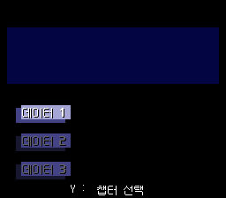

# v1.1 챕터 선택 사용법

불러오기 화면에서 다섯 장 중 하나를 바로 시작할 수 있습니다. 저장 데이터나 클리어 기록이 없어도 사용할 수 있습니다.

| 불러오기 화면의 Y: 챕터 선택 안내 | 데이터 1에서 다섯 챕터 선택 |
| --- | --- |
|  |  |

## 조작

1. **불러오기 화면에서 DATA 1~3 중 사용할 저장 슬롯을 선택합니다.**
2. SNES 패드의 **Y** 버튼을 눌러 챕터 선택 화면을 엽니다.
3. **↑/↓**로 장을 고르고 **A**를 누릅니다.
4. 장 이름과 저장 슬롯을 확인한 뒤 **A**를 한 번 더 누르면 시작합니다.
5. **B**를 누르면 이전 화면으로 돌아갑니다. 시작을 확정하기 전 취소하면 저장은 바뀌지 않습니다.

| 선택할 수 있는 장 |
| --- |
| 토리우미 아키코 사건 편 |
| 뉴욕 편 |
| 내부자 거래 편 |
| 교토 편 |
| 사장 교체극 편 |

| 데이터 3에서 교토 편 선택 | 시작 전 선택 슬롯 덮어쓰기 확인 |
| --- | --- |
|  |  |

## 저장과 엔딩 동작

**선택한 장을 처음부터 시작하며, 선택한 슬롯의 기존 진행과 이전 선택은 초기화됩니다.** 확인 화면에서 시작을 확정해야 저장이 바뀝니다. 다른 두 슬롯의 기록은 유지되며 일반 불러오기와 자동 저장도 기존 방식대로 사용할 수 있습니다.

**엔딩 후 저장이 사라지는 것은 원작 동작입니다. v1.1에서도 그대로 유지했습니다.** 다시 원하는 장을 플레이하려면 불러오기에서 Y로 챕터를 선택하세요.

## 기존 저장 사용

게임의 일반 저장 파일(SRAM, `.srm`)은 기존 형식과 호환됩니다. ROM 이름을 바꿨다면 기존 저장 파일을 백업하고 에뮬레이터가 찾는 새 ROM 이름에 맞춰 복사하세요. 기기에 따라 저장 폴더와 파일 이름 규칙이 다릅니다.

새 ROM을 완전히 다시 시작해 사용하세요. 이전 ROM에서 만든 에뮬레이터의 강제 저장 상태(`.state` 등)는 게임의 일반 저장과 별개이며 이번 변경의 호환성을 보장하지 않습니다.

[스크린샷 16장](SCREENSHOTS.md) · [검증 범위](VALIDATION.md)
