# 비공식 한글판 v1.11 스크린샷

v1.11 실행 화면 **16장**을 추가했습니다. 일반 실행 8장과 장면 진입 검증 실행 8장으로 촬영한 256×224 원본 PNG입니다. [챕터 선택 사용법](CHAPTER_SELECT.md) · [촬영 정보와 해시](screenshot_manifest.json)

## 불러오기와 챕터 선택

| 불러오기 화면의 챕터 선택 안내 | 도리우미 가쿠코로 수정한 챕터 선택 |
| --- | --- |
| 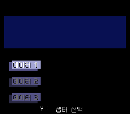 | 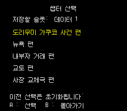 |

| 데이터 2 슬롯 선택 | 데이터 3 슬롯 선택 |
| --- | --- |
| 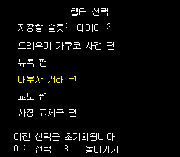 | 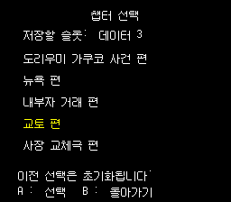 |

**도리우미 가쿠코 사건 편 시작 확인**

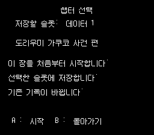

## 장 제목

| 도리우미 가쿠코 사건 편 제목 | 교토 편 제목 |
| --- | --- |
| 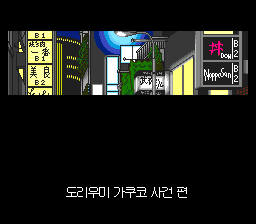 | 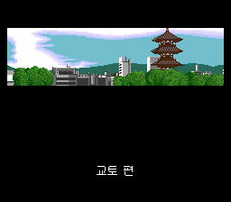 |

## 챕터 선택 후 대사 진행

| 도입부의 가쿠코 이름 | 가쿠코가 도운 사건 |
| --- | --- |
| 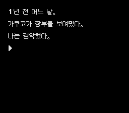 | 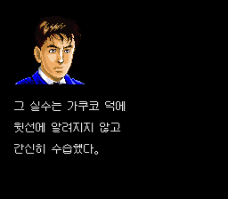 |

| 가쿠코 관련 선택지 | 술자리 서술의 자연스러운 표현 |
| --- | --- |
| 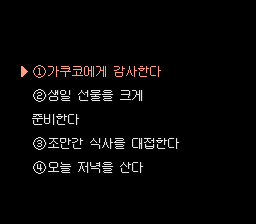 | 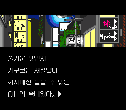 |

| 가쿠코와의 관계 조사 복원 | 도리우미 성 표기 통일 |
| --- | --- |
| 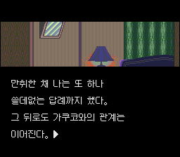 | 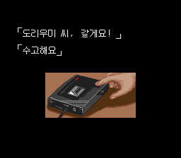 |

| 가쓰코 장면의 문장 연결 | 후반 대사의 주어 복원 |
| --- | --- |
| 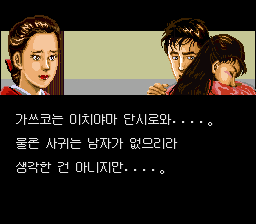 | 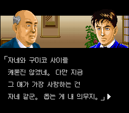 |

**뉴욕 편 진행**

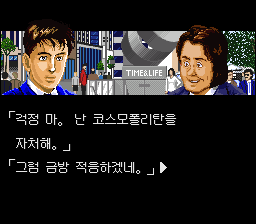

## 이전 버전 화면

[v1.0 갤러리 40장](SCREENSHOTS_v1.0.md)에서 오프닝·본편·엔딩 한글화 화면을 볼 수 있습니다. 당시 촬영 방식과 해시도 보존했습니다. [V0.81 갤러리 54장](SCREENSHOTS_V0.81.md)도 별도로 유지합니다.

[v1.1 당시 화면 16장](SCREENSHOTS_v1.1.md)도 이전 버전 기록으로 보존합니다. 수정 전 이름이 나오는 과거 화면은 현재 v1.11 이미지와 구분해 보세요.
