# 비공식 한글판 v1.0 스크린샷

이번 수정본에서 확인한 **40장**입니다. 256×224 원본 PNG를 그대로 실었습니다. 오프닝 4장은 최종 롬의 일반 실행 화면이며, 본편·엔딩은 해당 장면으로 진입하는 검증용 실행에서 촬영했습니다. [촬영 방식과 PNG 해시](screenshot_manifest_v1.0.json)

## 타이틀과 오프닝

| 메인 타이틀 | 오프닝 로고 |
| --- | --- |
| 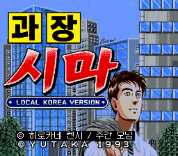 | 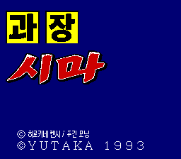 |

| 과장 임명장 | 시마 고사쿠 인물 소개 |
| --- | --- |
| 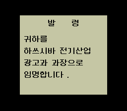 | 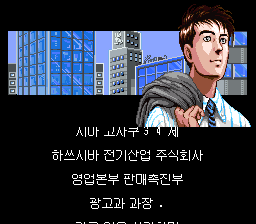 |

## 본편 대사

| 인쇄소 정보 유출 | 관리자의 역할 |
| --- | --- |
| 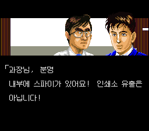 | 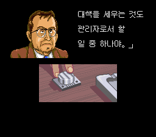 |

| 야베와의 대화 뒤 | 가족을 돌아보는 시마 |
| --- | --- |
| 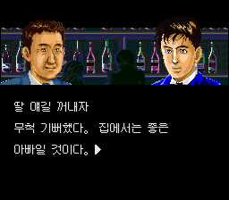 | 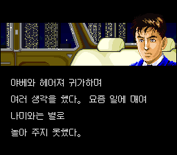 |

| 브로드웨이 제작비 | 뮤지컬 공연 |
| --- | --- |
| 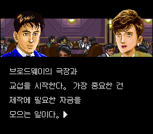 | 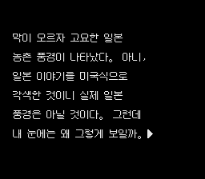 |

| 다음 만남을 기약하며 | 뉴욕에서의 업무 |
| --- | --- |
| 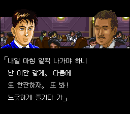 | 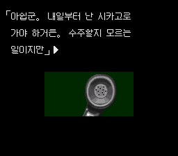 |

| 투자금에 관한 대화 | 사건을 돌아보는 독백 |
| --- | --- |
| 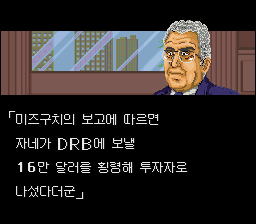 | 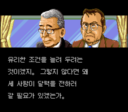 |

| 가시무라의 연락 | 상사들의 반응 |
| --- | --- |
| 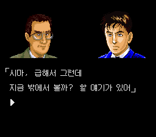 | 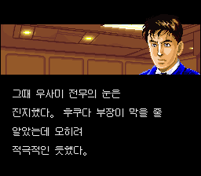 |

| 내부자 거래를 둘러싼 고민 | 동료와의 대화 |
| --- | --- |
| 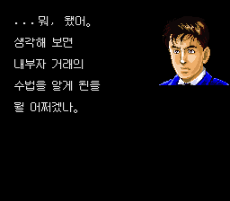 | 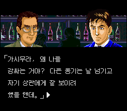 |

| 술자리의 가시무라 | 동료 사이의 오해 |
| --- | --- |
| 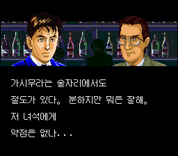 | 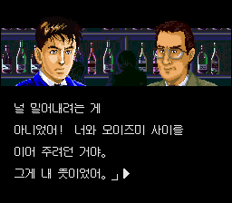 |

| 교토 지사의 상품 소개 | 마리코와의 대화 |
| --- | --- |
| 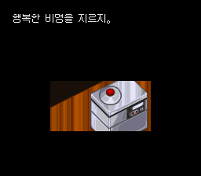 | 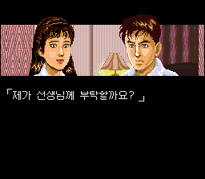 |

| 인물 이름 표기 | 술자리의 말투 |
| --- | --- |
| 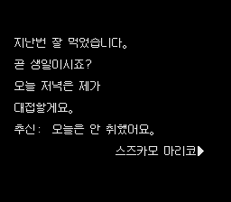 | 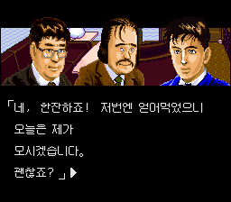 |

| 오마치와 샴페인 | 오마치가 받은 엽서 |
| --- | --- |
| 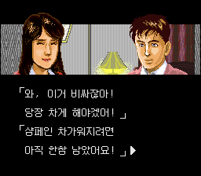 | 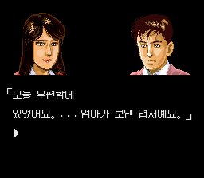 |

| 오마치와의 여행 이야기 | 아뇨 뒤 문장 간격 |
| --- | --- |
| 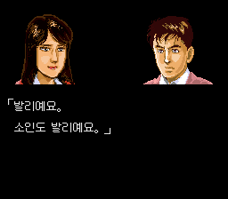 | 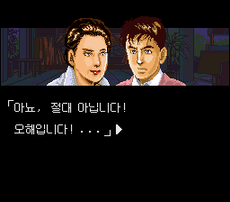 |

| 어순과 어절을 다듬은 독백 | 오마치와 공항으로 |
| --- | --- |
| 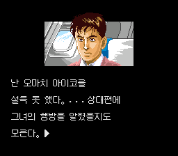 | 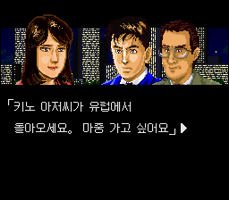 |

| 사장실에서 밝히는 소신 | 동료들의 뜻을 전하며 |
| --- | --- |
| 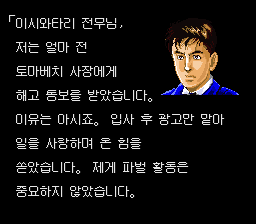 | 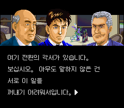 |

엔딩 후기·크레딧 8장 보기 · 스포일러

### 엔딩 후기 1

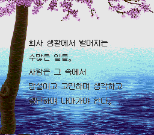

### 엔딩 후기 2

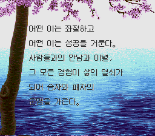

### 엔딩 후기 3

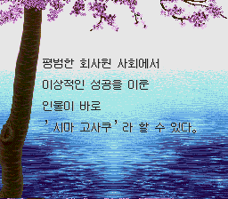

### 엔딩 후기 4

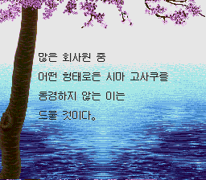

### 엔딩 후기 5

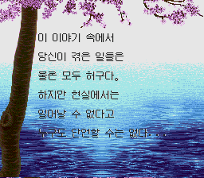

### 원작·감수 크레딧

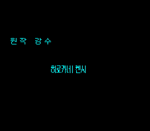

### 유타카 한글 로고

### 完과 한글화 표기

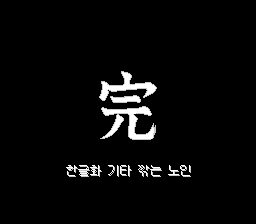

## 이전 버전 기록

[V0.81 갤러리 54장](SCREENSHOTS_V0.81.md)은 당시 촬영본입니다. v1.0 화면과 구분해 보존합니다.
