# 비공식 한글판 v1.1 스크린샷

v1.1 실행 화면 **16장**을 추가했습니다. 모두 일반 부팅과 패드 입력으로 촬영한 256×224 원본 PNG입니다. [챕터 선택 사용법](CHAPTER_SELECT_v1.1.md) · [촬영 정보와 해시](screenshot_manifest_v1.1.json)

## 불러오기와 챕터 선택

| 불러오기 화면의 Y: 챕터 선택 안내 | 데이터 1에서 다섯 챕터 선택 |
| --- | --- |
| 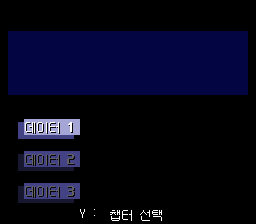 | 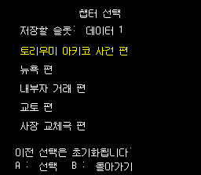 |

| 데이터 2에서 내부자 거래 편 선택 | 데이터 3에서 교토 편 선택 |
| --- | --- |
| 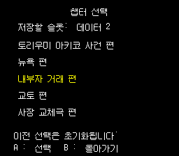 | 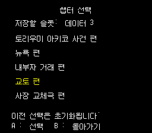 |

| 시작 전 선택 슬롯 덮어쓰기 확인 | 취소 후 기존 저장 화면으로 복귀 |
| --- | --- |
| 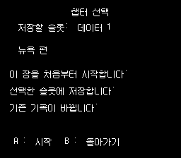 | 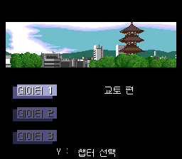 |

## 다섯 장의 시작 화면

| 토리우미 아키코 사건 편 시작 | 뉴욕 편 시작 |
| --- | --- |
| 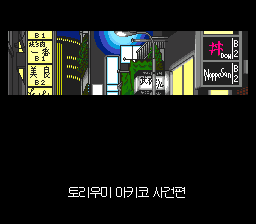 | 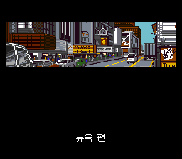 |

| 내부자 거래 편 시작 | 교토 편 시작 |
| --- | --- |
| 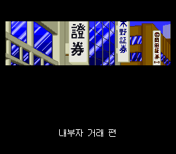 | 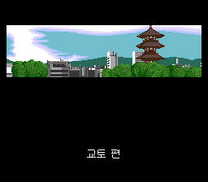 |

**사장 교체극 편 시작**

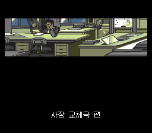

## 챕터 선택 후 대사 진행

| 토리우미 아키코 사건 편 대사 진행 | 뉴욕 편 대사 진행 |
| --- | --- |
| 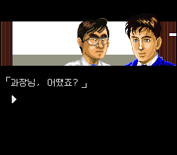 | 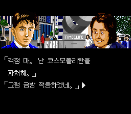 |

| 내부자 거래 편 대사 진행 | 교토 편 대사 진행 |
| --- | --- |
| 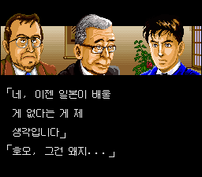 | 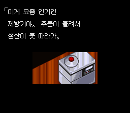 |

**사장 교체극 편 대사 진행**

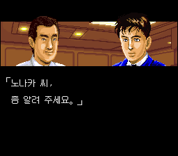

## 이전 버전 화면

[v1.0 갤러리 40장](SCREENSHOTS_v1.0.md)에서 오프닝·본편·엔딩 한글화 화면을 볼 수 있습니다. 당시 촬영 방식과 해시도 보존했습니다. [V0.81 갤러리 54장](SCREENSHOTS_V0.81.md)도 별도로 유지합니다.
